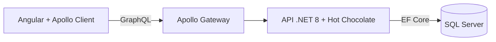

# Gestión de Órdenes de Exportación de Flores

MVP para gestionar órdenes de exportación de flores desde LATAM hacia USA

## Arquitectura



**Backend **

| Proyecto | Responsabilidad |
| --- | --- |
| `Ordenes.Domain` | Entidad `Order` y reglas de transición de estado |
| `Ordenes.Application` | Casos de uso (`OrderService`), DTOs, interfaz del repositorio |
| `Ordenes.Infrastructure` | EF Core, migraciones, repositorio, datos semilla |
| `Ordenes.Api` | Esquema GraphQL (queries, mutations) y manejo de errores |

**Frontend:** Angular organizado por features (`dashboard`, `orders`).

**Estados permitidos:** `CREATED → IN_TRANSIT → DELIVERED` y `CREATED → CANCELLED`.

## Cómo ejecutar

**Requisito:** Docker Desktop.

```bash
cp .env.example .env
docker compose up --build
```

| Servicio | URL |
| --- | --- |
| Frontend | http://localhost:4200 |
| Apollo Gateway | http://localhost:4000 |
| API GraphQL | http://localhost:5080/graphql |


## Tests

```bash
cd backend  && dotnet test
cd frontend && npm test -- --watch=false --browsers=ChromeHeadless
```

## Calidad y CI

- **Husky:** antes de cada commit ejecuta `ng lint` y `dotnet format`.
- **GitHub Actions:** build, lint y test de backend y frontend, y build de las imágenes Docker.

## Decisiones técnicas

- **Reglas en el dominio:** las transiciones de estado se validan en `Order.ChangeStatus`.
- **Errores claros:** las excepciones de negocio se devuelven como errores GraphQL con mensaje y código.
- **Frontend:** lazy loading por feature, Reactive Forms y un único servicio que centraliza Apollo y el manejo de errores.

## Mejoras futuras

- Autenticación y roles
- Paginación y búsqueda de órdenes
- Historial de cambios de estado

## Extras

- **Colección de Postman:** `docs/postman/MVP Ordenes.postman_collection.json`
  1. Importa el archivo en Postman 
  2. Con el backend corriendo, crea una orden, mueve por estados y prueba los casos de error
  3. Por defecto usa el gateway (`http://localhost:4000/graphql`); para la API directa cambia la variable `baseUrl` a `{{apiUrl}}`